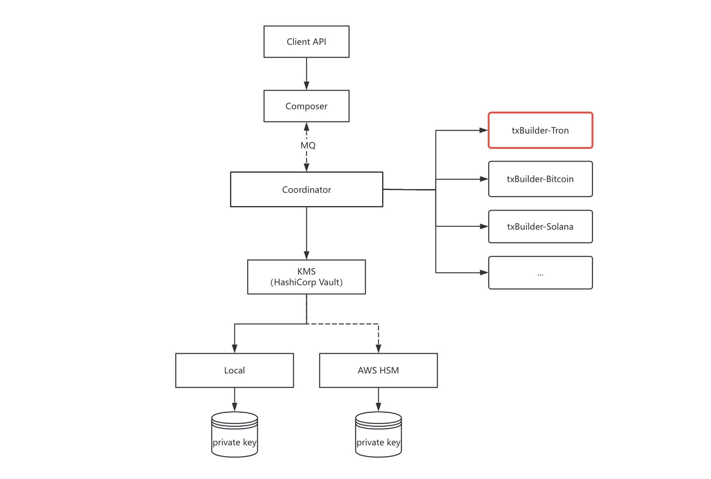

# txbuilder-tron

TRON 区块链交易构造 gRPC 服务，提供地址验证、余额检查、交易原始数据构造、交易广播等 API。


## 概述

**职责说明**：
- **txbuilder-tron**：负责 TRON 区块链的所有细节（交易构造、protobuf 组装、TRON API 调用）
- **Coordinator**：只需调用接口构造交易、调用 KMS 请求签名、调用广播

## 环境要求

- Go 1.25+
- protoc（用于编译 proto 文件）

## 目录结构

```
txbuilder-tron/
├── cmd/txbuilder-tron/
│   └── main.go              # 程序入口，gRPC 服务启动
├── internal/
│   ├── config/              # TOML 配置加载 & 日志初始化
│   │   ├── config.go
│   │   └── config_test.go
│   ├── service/             # gRPC handler 实现
│   │   ├── service.go
│   │   └── service_test.go
│   └── tron/                # TRON 相关工具
│       ├── address.go       # Base58 编解码、地址校验
│       ├── address_test.go
│       └── rpc.go           # TRON 节点 HTTP JSON-RPC 客户端
├── grpc/
│   ├── txbuilder.proto      # gRPC 服务和消息定义
│   ├── txbuilder.pb.go     # 生成的 protobuf 代码
│   └── txbuilder_grpc.pb.go
├── config/
│   └── config.toml          # 默认配置文件
├── scripts/
│   └── gen.sh              # protobuf 代码生成脚本
└── .golangci.yml           # linter 配置
```


## gRPC 接口

服务在 `host:port`（默认 `127.0.0.1:50051`）上暴露 `TxBuilder` gRPC 服务。

### 1. VerifyAddress

验证 TRON 地址（Base58check 格式，以 `T` 开头）。

```protobuf
rpc VerifyAddress(VerifyAddressRequest) returns (VerifyAddressResponse);
```

**请求：**


| 字段       | 类型     | 说明        |
| -------- | ------ | --------- |
| trace_id | string | 追踪 ID（必填） |
| address  | string | TRON 地址   |


**响应：**


| 字段       | 类型   | 说明     |
| -------- | ---- | ------ |
| is_valid | bool | 地址是否合法 |


### 2. VerifyContractAddress

验证 TRON 合约地址。

```protobuf
rpc VerifyContractAddress(VerifyContractAddressRequest) returns (VerifyContractAddressResponse);
```

**请求：**


| 字段       | 类型     | 说明        |
| -------- | ------ | --------- |
| trace_id | string | 追踪 ID（必填） |
| address  | string | 合约地址      |


**响应：**


| 字段       | 类型   | 说明     |
| -------- | ---- | ------ |
| is_valid | bool | 地址是否合法 |


### 3. CheckSufficientBalance

检查账户余额是否足够发起转账。

```protobuf
rpc CheckSufficientBalance(CheckSufficientBalanceRequest) returns (CheckSufficientBalanceResponse);
```

**请求：**


| 字段            | 类型     | 说明                                     |
| ------------- | ------ | -------------------------------------- |
| trace_id      | string | 追踪 ID（必填）                              |
| chain_code    | string | 链码，如 "tron"、“bitcoin”                   |
| coin_id       | string | 币种 ID                                  |
| is_basic_coin | bool   | `true` 表示 TRX（原生币），`false` 表示 TRC20 代币 |
| from_address  | string | 发送方地址                                  |
| amount        | string | 转账金额（TRX 单位为 Sun，代币为最小单位）              |
| contract      | string | 代币合约地址（`is_basic_coin=false` 时必填）      |


**响应：**


| 字段            | 类型   | 说明     |
| ------------- | ---- | ------ |
| is_sufficient | bool | 余额是否充足 |


### 4. BuildSignRawData

构造待签名的交易原始数据。

```protobuf
rpc BuildSignRawData(BuildSignRawDataRequest) returns (BuildSignRawDataResponse);
```

**请求：**


| 字段            | 类型     | 说明                                |
| ------------- | ------ | --------------------------------- |
| biz_id        | string | 业务 ID（必填，最多 36 字符）                |
| chain_code    | string | 链码，如 "tron"、“bitcoin”                              |
| coin_id       | string | 币种 ID                             |
| is_basic_coin | bool   | `true` 表示 TRX，`false` 表示 TRC20 代币 |
| coin_symbol   | string | 代币符号                              |
| from_address  | string | 发送方地址                             |
| to_address    | string | 接收方地址                             |
| amount        | string | 金额（必须是纯数字字符串）                     |
| contract      | string | 代币合约地址（`is_basic_coin=false` 时必填） |


**响应：**


| 字段      | 类型     | 说明                                    |
| ------- | ------ | ------------------------------------- |
| msg     | string | 原始数据的 SHA-256 哈希（十六进制字符串，用于签名）        |
| raw_data | string | 交易原始数据（十六进制字符串），用于后续组装完整交易         |


### 5. TxBroadcast

广播已签名的交易数据到 TRON 网络。

```protobuf
rpc TxBroadcast(TxBroadcastRequest) returns (TxBroadcastResponse);
```

**请求：**


| 字段       | 类型     | 说明                         |
| -------- | ------ | -------------------------- |
| trace_id | string | 追踪 ID（必填）                   |
| raw_data | string | 交易原始数据（十六进制字符串，1-4096 字符）   |
| signature | string | 签名数据（十六进制字符串，1-512 字符）      |


**响应：**


| 字段      | 类型   | 说明      |
| ------- | ---- | ------- |
| success | bool | 广播是否成功 |


### 6. ConvertAddress

将 PKIX PEM 格式的公钥转换为 TRON 地址（Base58Check 编码，以 `T` 开头）。

**算法说明：**
1. 解析 PEM（`-----BEGIN PUBLIC KEY-----`），提取 PKIX SubjectPublicKeyInfo
2. 验证曲线 OID 为 secp256k1（1.3.132.0.10）
3. 提取未压缩的 EC 点（0x04 || x || y，共 65 字节）
4. 对 65 字节做 **Keccak-256**（Legacy Keccak，非 NIST SHA3-256）
5. 取哈希最后 20 字节，前面加 `0x41` → 共 21 字节 payload
6. 计算 SHA256(SHA256(payload)) 前 4 字节作为 checksum，拼接后 Base58 编码

```protobuf
rpc ConvertAddress(ConvertAddressRequest) returns (ConvertAddressResponse);
```

**请求：**


| 字段              | 类型     | 说明                                     |
| --------------- | ------ | -------------------------------------- |
| trace_id        | string | 追踪 ID（必填）                              |
| pkix_pubkey_pem | string | PKIX PEM 格式的公钥（`-----BEGIN PUBLIC KEY-----`） |


**响应：**


| 字段     | 类型     | 说明            |
| ------ | ------ | ------------- |
| address | string | TRON 地址（Base58Check，以 T 开头） |


## 调用示例


### 使用 grpcurl

先启动服务，再用 grpcurl 调用：

```bash
# 启动服务
go run ./cmd/txbuilder-tron/main.go

# 验证地址
grpcurl -plaintext -d '{
  "trace_id": "test-001",
  "address": "TLa2f6VPqBkREki5JsqLkNqyjLRBaMFKDY"
}' localhost:50051 chain.TxBuilder/VerifyAddress

# 检查余额（TRX）
grpcurl -plaintext -d '{
  "trace_id": "test-002",
  "chain_code": "tron",
  "coin_id": "trx",
  "is_basic_coin": true,
  "from_address": "TLa2f6VPqBkREki5JsqLkNqyjLRBaMFKDY",
  "amount": "1000000"
}' localhost:50051 chain.TxBuilder/CheckSufficientBalance

# 构造 TRX 转账交易
grpcurl -plaintext -d '{
  "biz_id": "tx-001",
  "chain_code": "tron",
  "coin_id": "trx",
  "is_basic_coin": true,
  "coin_symbol": "TRX",
  "from_address": "TLa2f6VPqBkREki5JsqLkNqyjLRBaMFKDY",
  "to_address": "TN3W4H6rK4f4tRhqDaJf9u5Q5yT5Z3s8fB",
  "amount": "1000000"
}' localhost:50051 chain.TxBuilder/BuildSignRawData
# 响应示例: {"msg": "...", "raw_data": "..."}

# 广播已签名的交易（raw_data 和 signature 由 Coordinator 提供）
grpcurl -plaintext -d '{
  "trace_id": "broadcast-001",
  "raw_data": "0a86010a028f162208022308...",
  "signature": "abcd1234..."
}' localhost:50051 chain.TxBuilder/TxBroadcast

# 将 PKIX PEM 公钥转换为 TRON 地址
# pkix_pubkey_pem 需要是 secp256k1 曲线（1.3.132.0.10）的公钥
grpcurl -plaintext -d '{
  "trace_id": "convert-001",
  "pkix_pubkey_pem": "-----BEGIN PUBLIC KEY-----\nMFYwEAYHKoZIzj0CAQYFK4EEAAoDQgAEPShgff2ebuv9APjmHY7cZCjj8zzNEKfM\n1t2HgBZboXlkctVu4iomxUHfuOCJuKcijpVWNHTVSgRzKVjBhO3Bhw==\n-----END PUBLIC KEY-----"
}' localhost:50051 chain.TxBuilder/ConvertAddress
```


### Go 客户端示例

```go
package main

import (
	"context"
	"fmt"

	"github.com/koku-web3/txbuilder-tron/grpc"
	"google.golang.org/grpc"
	"google.golang.org/grpc/credentials/insecure"
)

func main() {
	conn, err := grpc.NewClient("localhost:50051", grpc.WithTransportCredentials(insecure.NewCredentials()))
	if err != nil {
		panic(err)
	}
	defer conn.Close()

	client := grpc.NewTxBuilderClient(conn)
	ctx := context.Background()

	// 验证地址
	resp, err := client.VerifyAddress(ctx, &grpc.VerifyAddressRequest{
		TraceId: "test-001",
		Address: "TLa2f6VPqBkREki5JsqLkNqyjLRBaMFKDY",
	})
	if err != nil {
		panic(err)
	}
	fmt.Printf("地址合法: %v\n", resp.IsValid)

	// 构造 TRX 转账
	txResp, err := client.BuildSignRawData(ctx, &grpc.BuildSignRawDataRequest{
		BizId:       "tx-001",
		ChainCode:     "tron",
		CoinId:      "trx",
		IsBasicCoin: true,
		CoinSymbol:  "TRX",
		FromAddress: "TLa2f6VPqBkREki5JsqLkNqyjLRBaMFKDY",
		ToAddress:   "TN3W4H6rK4f4tRhqDaJf9u5Q5yT5Z3s8fB",
		Amount:      "1000000",
	})
	if err != nil {
		panic(err)
	}
	fmt.Printf("签名消息: %s\n", txResp.Msg)

	// 将 PKIX PEM 公钥转换为 TRON 地址
	convertResp, err := client.ConvertAddress(ctx, &grpc.ConvertAddressRequest{
		TraceId: "convert-001",
		PkixPubkeyPem: "-----BEGIN PUBLIC KEY-----\nMFYwEAYHKoZIzj0CAQYFK4EEAAoDQgAEPShgff2ebuv9APjmHY7cZCjj8zzNEKfM\n1t2HgBZboXlkctVu4iomxUHfuOCJuKcijpVWNHTVSgRzKVjBhO3Bhw==\n-----END PUBLIC KEY-----",
	})
	if err != nil {
		panic(err)
	}
	fmt.Printf("TRON 地址: %s\n", convertResp.Address)
}
```


## 开发


### 生成 protobuf 代码

```bash
# 进入项目根目录
cd ./txbuilder-tron

# 重新生成 Go 代码
protoc --go_out=. --go_opt=paths=source_relative \
       --go-grpc_out=. --go-grpc_opt=paths=source_relative \
       grpc/txbuilder.proto
```

需要安装：`protoc`、`protoc-gen-go`、`protoc-gen-go-grpc`。

### 运行测试

```bash
go test ./...
```


### 代码检查

```bash
golangci-lint run ./...
```


## 许可证

见 [COPYING](./COPYING)。